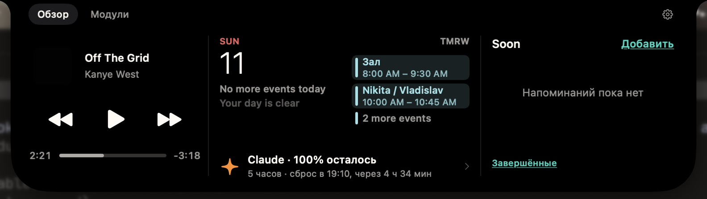

# Oasis



Личный Dynamic Island для MacBook по мотивам [Alcove](https://tryalcove.com/). Остров живёт над вырезом экрана: в покое совпадает с ним по размеру, при событиях расширяется и показывает музыку, HUD громкости и яркости, зарядку, календарь. По наведению или клику раскрывается в панель с управлением.

## Зачем

- **Для себя.** Alcove уже куплен и стоит на Mac. Смысл своего аналога — модули, которых в Alcove нет и не будет: статус агентов Claude Code, пайплайны GitLab, задачи Asana, напоминания о созвонах.
- **Как учебный проект.** Разобраться в AppKit-окнах поверх системы, SwiftUI-анимациях на пружинах, MediaRemote и работе с железом Mac.
- **Проверить агентскую разработку** на задаче, где качество упирается в ощущение от анимаций. Для этого собран эталон с замерами (см. «Reference pack» ниже): агенты сверяют свой рендер с Alcove в числах, а не на глаз.

Исходники и предварительные сборки доступны на [GitHub](https://github.com/Nikolinjho/oasis).

Свои модули строятся на контракте активности: уведомление — `IslandAlert` (вид, приоритет, длительность, звук), компакт — `ActivityLayout` (иконка, кольцо или текст, строка peek). Отладочный пункт для каждого — в `DebugCatalog`.

## Жесты

В **Settings → General → Очередь пиков** выбирается **Вид**: строка под текущим событием или отдельная капсула. Для капсулы доступна **Позиция**: слева или справа от острова. Счётчик показывает ожидающие уведомления, нажатие открывает их список. При пустой очереди индикатор скрывается. Настройки сохраняются после перезапуска.

Скролл двумя пальцами по раскрытому острову переключает контент внутри виджета:

- **вниз** — следующий вид по кругу: Duo → плеер → календарь → Claude Code. Claude Code появляется в цикле, когда модуль включён и есть данные. Вид меняется сразу, не дожидаясь отпускания, когда ход острова доходит до 21 pt (105 единиц дельты скролла), с отдачей трекпада, один раз за жест. Отпустил раньше — вид не меняется;
- **вверх** — закрыть остров так же: на 21 pt хода, сразу, с отдачей трекпада;
- горизонтальный скролл и инерция игнорируются, вне раскрытого острова скролл уходит приложению под ним.

Числа — в `SwipeTracker` (`cycleThreshold`, `closeThreshold`, `pointsPerDelta`).

## Яндекс Музыка

В **Settings → Now Playing → Source** выключи Automatic, выбери **Yandex Music** и нажми **Connect…**. Выбор источника сам по себе не перезапускает клиент. Подтверждение подключения предупреждает о перезапуске, возможной потере позиции и локальном порте отладки, через который другие процессы этого Mac получают доступ к клиенту. Авторизация остаётся в установленной Яндекс Музыке.

Остров читает настольный плеер и управляет им даже при воспроизведении в Chrome. При закрытом или неготовом клиенте настройки показывают причину, выбранный Яндекс не переключается на System. Automatic использует System.

Кнопки отражают доступные команды текущего контекста. Сердце показывает фактический лайк, перемотка и лайк проверяют идентификатор трека. В «Моей волне» shuffle недоступен, repeat переключается между выключенным и повтором одного трека. Громкость управляет системным выходом. Копирование ссылки и удалённые устройства пока не поддерживаются.

**Disconnect…** предлагает обычный перезапуск Яндекс Музыки для закрытия порта интеграции. Выход из Oasis закрывает соединение, но порт клиента остаётся открытым до его обычного перезапуска. Интерфейс плеера неофициальный, после обновления клиента возможен статус несовместимой версии.

## Claude Code

### Агенты и ответы

В **Settings** открой **Claude Code**, затем в разделе **Агенты и ответы** нажми **Подключить**. Подключение записывает локальные hooks Claude Code. Уже запущенный CLI нужно перезапустить, чтобы он загрузил их. Обычный запуск Oasis не подключает hooks автоматически.

Панель показывает отдельные сессии Claude Code и наблюдаемых подагентов. В ней можно ответить на вопрос, выбрать один или несколько вариантов, разрешить действие один раз или отклонить его. У каждого запроса свой черновик. Произвольное сообщение агенту, который сейчас не спрашивает, отправить нельзя.

В поле ответа **Enter** добавляет строку, **Cmd+Enter** отправляет заполненный ответ, **Escape** закрывает панель без ответа. Размер выбирается в настройках: **640 × 320 pt** или **560 × 288 pt**.

Опросник появляется одновременно в терминале Claude Code и в Oasis. Ответить можно в любом интерфейсе. Первый отправленный ответ завершает запрос, второй интерфейс прекращает ожидание. Выбор вариантов без отправки не завершает вопрос. Для этого нужен Claude Code **2.1.296 или новее**. При обновлении прежнего подключения нажми **Обновить** и перезапусти CLI.

Вопросы, запросы разрешений и черновики хранятся в памяти Oasis и исчезают после выхода из приложения. Обмен идёт локально, через helper и mod Claude Code. Срок ответа в Oasis – **590 секунд**, его истечение не закрывает штатный опросник в терминале. Если Oasis недоступен, в терминале можно ответить сразу. Разовые разрешения пока обрабатываются прежним синхронным hook.

### Лимиты

Лимиты подключаются отдельно от агентов. В **Settings** открой **Claude Code**, затем в разделе **Подключение лимитов** нажми **Подключить**. Oasis устанавливает локальный statusline-скрипт, который сохраняет только лимиты подписки из payload Claude Code. Подключение доступно и при выключенном модуле. После следующего ответа Claude Code данные появятся в острове. Настройки Claude Code при обычном запуске Oasis не меняются.

Если строка статуса уже настроена, можно **сохранить прежнюю строку** в цепочке с Oasis, **заменить прежнюю строку** или отменить подключение. **Отключить** восстанавливает прежний `statusLine` и сохраняет изменения остальных настроек. Если после подключения строку поменяли вручную, отключение убирает запись Oasis и оставляет текущую строку. Затем можно подключиться снова.

Раскрытый вид показывает остаток окон 5 часов и 7 дней, время сброса и свежесть данных. Отсутствующее окно подписано «нет данных». После ожидаемого сброса остаток 100% помечается «расчёт»: это ожидание нового payload, а не подтверждённый замер. Старше 30 минут данные помечаются устаревшими, прогноз скрывается.

Peek предупреждает при переходе ниже выбранных порогов 50, 25, 10 и 5%, а также при исчерпании. Предупреждение о скором исчерпании строится по наблюдаемому расходу текущего окна. Срочные предупреждения на 5% и 0% доступны и в полноэкранном режиме. Уведомление о сбросе включается отдельно, по умолчанию оно выключено. Звуки подчиняются общему переключателю Play sounds.

Прогноз дня использует локальную историю наблюдений недельного лимита. «Наблюдаемый расход» учитывает только зафиксированные изменения. Оценка к полуночи или концу рабочего дня продолжает текущий темп и появляется при достаточном числе замеров. Ориентир 14% в день помогает распределить недельный лимит, но не гарантирует будущий расход. Debug-снимки живут только в памяти и удерживаются до **Resume Live Data** (`claude.live`).

## Codex

В **Settings / Codex** нажми **Подключить**. Oasis подключается вторым клиентом к общему локальному серверу установленного Codex CLI. Сервер запускает сам Codex. Oasis не меняет `config.toml`, hooks или cmux и не управляет сервером.

Открой **Модули / Codex**. Сессии, вопросы и черновики отделены от Claude Code. Оповещения обоих провайдеров идут в одной очереди с одинаковым приоритетом и порядком поступления.

Опросник открыт одновременно в терминале и Oasis. Первый принятый сервером ответ завершает ожидание в обоих интерфейсах. Выбор варианта без отправки не завершает запрос. Черновики независимые. Варианты и собственный ответ доступны по условиям вопроса, секретный ответ вводится в защищённое поле. Завершение запроса отмечается нейтрально: сервер не сообщает, какой интерфейс ответил.

Если сессия не появилась, запусти новую командой `codex --remote unix://`. Это работает и через обёртку cmux. Уже открытые автономные сессии и запуск с `--no-daemon` недоступны второму клиенту. Интеграция проверена на Codex CLI **0.160.1** с общим app-server.

При разрыве подключения старые формы становятся недоступными, черновики удаляются. Повторное подключение восстанавливает только ещё ожидающие запросы, с новыми идентификаторами. Ответы и черновики не сохраняются на диск и не выводятся в диагностике. Время ожидания определяет сервер Codex. Закрытие и отключение Oasis не отменяют запрос в терминале. Лимиты Codex, разрешения на инструменты и произвольный чат в этот модуль не входят.

## Лицензия и ограничения

Оригинальный код и документация Oasis распространяются по [лицензии MIT](LICENSE).
Сторонние материалы сохраняют свои лицензии и права владельцев – см. [THIRD_PARTY.md](THIRD_PARTY.md).

- **Ассеты Alcove** (звуки, видео AirPods, иконки) не входят в MIT-лицензию Oasis. Папки `assets/` и `site/` исключены из Git. Скрипт сборки может включать локальные ассеты, права на их распространение нужно получать отдельно.
- **Код Alcove** закрытый, его здесь нет. Всё, что знаем об устройстве, получено из бандла, сайта и записей экрана.
- **T3Notch** ([разбор](references/t3notch.md)) используется как учебник по окну над вырезом. Лицензии у него нет, поэтому код не копируем, только паттерны.


## Стек

| Слой | Что |
|---|---|
| Язык | Swift 6 (strict concurrency), тулчейн Xcode 27 / Swift 6.4 |
| UI | SwiftUI внутри AppKit: `NSPanel` + `NSHostingView` |
| Сборка | SwiftPM без Xcode-проекта + `Scripts/bundle.sh` собирает `.app` с Info.plist. Без `.pbxproj` параллельные агенты не конфликтуют |
| Минимальная macOS | 26 (разработка на 27) |
| Подпись | бесплатный Apple Development (Personal Team). Стабильная подпись нужна, чтобы macOS не сбрасывала разрешения при каждой пересборке |
| Sandbox | выключен: нужны приватные фреймворки, Apple Events и перехват клавиш |
| Тесты | `swift test`: машина состояний, геометрия, парсинг источников |
| Стиль | swift-format из тулчейна (раскладка) + SwiftLint 0.65.1 в `app/Vendor` (правила). `Scripts/lint.sh --check` — перед каждым коммитом |
| Проверка анимаций | `capture/tools/track.py` и `fit.py`: записываем прототип, меряем габариты по кадрам, сравниваем пружины с Alcove |

**Системные API по модулям:**

| Модуль | API |
|---|---|
| Музыка | [mediaremote-adapter](https://github.com/ungive/mediaremote-adapter) (MediaRemote через системный perl). Запасной путь — AppleScript к Music и Spotify |
| HUD громкости | CoreAudio + перехват медиаклавиш через CGEventTap (нужен Accessibility) |
| HUD яркости | приватный DisplayServices |
| Зарядка | IOKit power sources |
| Календарь | EventKit |
| Codex | Опросники одновременно в терминале и Oasis через общий локальный app-server. Отдельная панель и настройки, общая очередь оповещений с Claude Code |
| Claude Code | Агенты, вопросы и разовые разрешения через локальные hooks и Unix socket. Отдельно – лимиты подписки из statusline, пороговые уведомления и прогноз расхода |
| Автозапуск | ServiceManagement (`SMAppService`) |

## MVP

> Закрыт 2026-09-28: план `docs/superpowers/plans/2026-09-27-p0-mvp-closure.md` (локально). Внешний монитор и виртуальный вырез перенесены в P2. Следующий этап — P1, план `2026-09-27-p1-activity-platform.md`.

**Цель MVP:** остров, который в основных сценариях ощущается как Alcove. Проверяется замерами, а не на глаз.

### Входит

1. **Остров над вырезом.** Прозрачное окно фиксированного размера, внутри анимируется только форма. Squircle-углы и вогнутые «плечи» у menu bar. Клики вне формы проходят в menu bar. Для внешнего монитора — виртуальный вырез.
2. **Машина состояний со сжатием.** При смене активности остров сначала сжимается почти до выреза (~0.33 с), затем раскрывается в новое состояние (~0.45 с). Приоритеты: HUD и уведомления важнее live activity.
3. **Музыка.**
   - компакт 261×32: обложка слева, волна справа в цвете обложки
   - peek 283×51: бегущая строка с названием
   - раскрытый плеер 370×175: обложка, название и артист, прогресс, кнопки
   - смена трека: 3D-переворот обложки с проявлением из блюра
4. **HUD громкости и яркости.** 374×32, растёт только в ширину, иконка и подпись слева, полоска справа.
5. **Зарядка.** 357×32: «Charging» и процент с батарейкой.
6. **Раскрытие по hover и клику.** Промежуточное hover-состояние и полная панель duo: плеер + дата и ближайшее событие календаря.
7. **Меню в menu bar** и минимальное окно настроек: автозапуск, раскрытие по наведению, выбор экрана.

### Не входит

Экран блокировки, погода, AirPods, Focus, свайпы, прогрессивный блюр, полное окно настроек (13 экранов), автообновление. Всё это — после MVP, по мере надобности.

### Критерии готовности

- Все состояния из списка выше работают на MacBook Pro 16" и на внешнем мониторе.
- Размеры состояний совпадают с Alcove в пределах ±2 pt.
- Пружины раскрытия, схлопывания, сжатия и HUD, снятые `track.py` с записи прототипа, совпадают с Alcove: перелёт в пределах ±2 pt, время затухания в пределах ±50 мс.
- Menu bar под островом остаётся кликабельным.
- Пересборка не сбрасывает разрешения.

### План

| Фаза | Что | Оценка по часам |
|---|---|---|
| 0 | каркас: окно, форма, машина состояний, контракт модуля | 3–4 ч |
| 1 | модули параллельно: музыка, HUD, зарядка и календарь, настройки | 3–4 ч |
| 2 | интеграция и сверка с эталоном по записям, 2–3 итерации | полдня |
| 3 | полировка и крайние случаи | 1–2 дня |

Перед стартом нужно одно: добавить Apple ID в Xcode (Settings → Accounts), чтобы появился сертификат Personal Team.

## Структура репозитория

| Путь | Что |
|---|---|
| `app/` | код приложения: SwiftPM-пакет, `Scripts/bundle.sh` собирает `build/Oasis.app` |
| `motion/` | геометрия, пружины, тайминги. `motion.md` — главный документ, `AlcoveMotion.swift` — константы |
| `design/` | палитра Alcove: 66 цветов, JSON, Swift |
| `architecture/` | как устроен Alcove: модули, API, приватные обходы, все UI-строки |
| `assets/` | звуки, видео AirPods, иконки из бандла Alcove (только для локальной сборки) |
| `site/` | исходники tryalcove.com с веб-демо острова |
| `capture/` | сценарии записи, скрипты замеров, разборы записей в `analysis/` |
| `references/` | разборы чужих проектов (T3Notch) |

## Сборка и запуск

```bash
cd app
./Scripts/make-cert.sh        # один раз: сертификат для стабильной подписи
./Scripts/fetch-adapter.sh    # один раз: mediaremote-adapter для музыки (нужен cmake)
./Scripts/fetch-swiftlint.sh  # один раз: SwiftLint 0.65.1 в Vendor/swiftlint
./Scripts/bundle.sh           # сборка build/Oasis.app
./Scripts/lint.sh             # форматирование и линт; --check только проверяет
open build/Oasis.app
```

Рабочая копия — одна, в `~/Applications`: `./Scripts/install.sh` собирает release, гасит нативный Alcove и запущенные копии, кладёт бандл в `~/Applications/Oasis.app` и запускает его. Launch at Login включать из этой копии. Сборки в `build/` и worktree — только для отладки: у всех один bundle id, и с несколькими копиями разрешения и ссылки `oasis://` путаются.

Отладочные состояния без железа: меню Debug у иконки в menu bar или ссылка
`open -g -a "$PWD/build/Oasis.app" "oasis://debug/<id>"` (id — в `Sources/Oasis/Debug/DebugCatalog.swift`).

Сверка анимаций с эталоном: `open -n app/build/Oasis.app --args --demo-after 3`, затем
`capture/record.sh demo 21` и `PYTHON=/usr/bin/python3 capture/tools/measure.sh capture/recordings/demo.mov`.
Файл записи перед повторной записью удалить: `screencapture` не перезаписывает существующий.

## Reference pack: ключевые числа

Сверено с записями нативного Alcove 26.09.2026 (подробно — `capture/analysis/README.md`). Где нативные числа расходятся с веб-демо, верны нативные.

| Что | Значение |
|---|---|
| Покой (MacBook Pro 16") | 186×32, совпадает с вырезом |
| Раскрытие | до 365×175 (duo) или 370×175 (плеер), пружина `175/16`, перелёт ~9.5% |
| Схлопывание | `.smooth(duration: 0.4)`, без отскока |
| Смена активности | сжатие до ~195 за 0.33 с, раскрытие за 0.45 с |
| HUD | 374×32, `.smooth(duration: ~0.45)` |
| Цвета | фон `#0C0A09`, текст `#FFFAF4`: тёплые, не чистые чёрный и белый |
| Squircle | smoothing 0.65 |

Осталось записать: AirPods, Low Power, Focus, уведомление календаря, свайпы, музыку из Music или Spotify (`capture/scenarios.md`).
